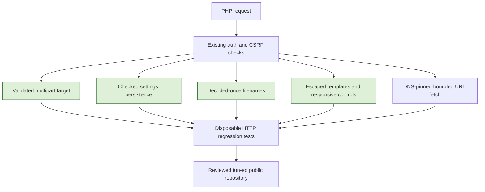

# Upstream issue assessment and first-batch plan

Status: first batch implemented, verified and published to the new public `fun-ed/tinyfilemanager` repository.

## Goal

Publish a tested, independently maintained public repository under `fun-ed`, preserving upstream history and the GPL license. Evaluate bugs, security, features, UI/UX and quality-of-life requests without treating every open issue as a confirmed defect. The initial inventory contains 237 open upstream issues as retrieved on 2026-10-17. Titles were screened across that inventory; only the prioritized reports below were investigated in depth. This is not a full security audit.

## Existing local changes

The assessment began with uncommitted integrations of upstream PRs [#1443](https://github.com/prasathmani/tinyfilemanager/pull/1443), [#1439](https://github.com/prasathmani/tinyfilemanager/pull/1439), [#1412](https://github.com/prasathmani/tinyfilemanager/pull/1412) and [#988](https://github.com/prasathmani/tinyfilemanager/pull/988). The session fix additionally rotates the CSRF token on login. Eight local regression checks passed on PHP 8.5.11 before this assessment. These changes are retained in the first-batch implementation below.

## Prioritized assessment

| Category | Upstream reports | Finding and proposed treatment |
| --- | --- | --- |
| Security | [#1099](https://github.com/prasathmani/tinyfilemanager/issues/1099) | Session fixation addressed by the already integrated session and CSRF rotation. Retain the regression tests. |
| Security | [#1341](https://github.com/prasathmani/tinyfilemanager/issues/1341), [#1098](https://github.com/prasathmani/tinyfilemanager/issues/1098) | View/edit text reaches the document title without escaping; non-image filenames reach an unescaped title attribute. Apply existing `fm_enc()` at these sinks and related symlink text output. Quote attribute values. |
| Security | [#1356](https://github.com/prasathmani/tinyfilemanager/issues/1356), [#1366](https://github.com/prasathmani/tinyfilemanager/issues/1366) | User selected preserving URL upload with a complete fail-closed constrained downloader. Validate and pin resolved public addresses, restrict protocols and ports, reject or revalidate redirects, and enforce time/byte limits. An insecure stream fallback is unacceptable. |
| Security | [PR #1419](https://github.com/prasathmani/tinyfilemanager/pull/1419) | Multipart extension checks and written filename disagree. Derive the destination filename from the uploaded filename, preserve dotfiles and case, constrain folder paths and chunk destinations. Do not apply the PR unchanged because it rejects dotfiles and reconstructs trailing-dot names incorrectly. |
| Data loss / bug | [#1415](https://github.com/prasathmani/tinyfilemanager/issues/1415), [#1246](https://github.com/prasathmani/tinyfilemanager/issues/1246) | Settings replace the first three configuration-file lines and report success regardless of write outcome. Replace only a safely identified `$CONFIG` assignment, preserve other bytes, use checked atomic persistence, and return a real error on failure. Account for OPcache after successful persistence. |
| Bug / UX | [#1271](https://github.com/prasathmani/tinyfilemanager/issues/1271) | PHP has already decoded query/form values; the download handler decodes again and corrupts literal plus signs. Remove redundant decoding at matched request producers/consumers and test plus, spaces and literal percent sequences. |
| Data loss / UX | [#1328](https://github.com/prasathmani/tinyfilemanager/issues/1328), [#1282](https://github.com/prasathmani/tinyfilemanager/issues/1282) | The integrated editor PR addresses expired-session, stale-token and false-success paths. Treat syntax-highlighting complaints separately. |
| UI/UX | [#1428](https://github.com/prasathmani/tinyfilemanager/issues/1428), [#1349](https://github.com/prasathmani/tinyfilemanager/issues/1349), [#1252](https://github.com/prasathmani/tinyfilemanager/issues/1252), [#1285](https://github.com/prasathmani/tinyfilemanager/issues/1285) | Assess mobile table/navigation clipping against current Bootstrap templates before choosing a small CSS fix. Verify narrow and desktop viewports, keyboard access, long paths and menu placement. Avoid replacing the table implementation. |
| UI/UX | [#1061](https://github.com/prasathmani/tinyfilemanager/issues/1061) | Assess whether read-only users unnecessarily lose advanced search. A read operation should not depend on write controls. |
| Feature | [#1387](https://github.com/prasathmani/tinyfilemanager/issues/1387), [#1317](https://github.com/prasathmani/tinyfilemanager/issues/1317) | Folder ACLs and TOTP need an explicit permission/recovery model and security review. Defer from a small stabilization batch. |
| Feature / performance | [#1259](https://github.com/prasathmani/tinyfilemanager/issues/1259) | Pagination requires a decision between client-side paging and server-side listing/search. Measure representative large directories before designing it. |
| Nice to have | [#1235](https://github.com/prasathmani/tinyfilemanager/issues/1235) | Copy-link action needs a clear distinction between authenticated manager URLs and public file URLs, plus clipboard/HTTPS fallback behavior. Defer until URL and disclosure policy are explicit. |
| Security documentation | [#1225](https://github.com/prasathmani/tinyfilemanager/issues/1225) | README links to an externally hosted password-hash generator. Prefer the existing authenticated local generator or a local PHP command; never send passwords to that third party. |
| Unverifiable report | [#1384](https://github.com/prasathmani/tinyfilemanager/issues/1384) | Public issue lacks the private report's technical details. Do not claim it reproduced or fixed. |
| Style | [#1444](https://github.com/prasathmani/tinyfilemanager/issues/1444) | A PSR-12 cleanup is lower priority than data integrity/security. Preserve the mixed PHP/template layout instead of claiming blanket PSR-12 compliance. |

## Approved first-batch scope

May modify `tinyfilemanager.php`, `tests/pr_regressions.py`, focused `tests/security_helpers.php`, `README.md`, `AGENTS.md`, this plan, `docs/runtime-recommendation.md`, minimal root `.gitignore`/`.dockerignore` files, `.agents/skills/tinyfilemanager-maintenance/SKILL.md` and `.omp/agents/tinyfilemanager-maintainer.md`. `Dockerfile` may add the PHP cURL extension required by the safe downloader, the existing health-check executable, and the translation catalog omitted from the original image. Compose comments explain atomic-write limitations. Retain the single-file application, existing CDN libraries and standard-library test harness. Do not add an application framework or third-party package dependency.

Do not publish `.serena/`, local `config.php`, managed `data/`, session files, credentials, logs, backups, personal infrastructure metadata or tool output. Preserve the upstream `origin` remote; add a distinct personal publishing remote.

Settings persistence, upload path handling and authentication are Core changes. Inspect their affected callers line by line, add positive and negative regression cases, and obtain an independent code review before publication.

## Verification and completion

- Extend the existing disposable-copy HTTP tests before applying each fix. Cover valid behavior, rejected input and unchanged data on failure.
- Settings fixtures must include sample-style comments, missing/existing/multiline assignment, LF/CRLF, literal dollar/backslash values and failed persistence.
- Upload cases must cover extension mismatch, ordinary/dotfile/nested upload, multiple chunks, conflicts, traversal and symlink destinations without writing outside the fixture root.
- Filename cases must include plus, spaces and literal percent sequences. XSS cases must inspect rendered output and browser inertness when practical.
- Run `mise exec -- php -l tinyfilemanager.php`, `mise exec -- python3 tests/pr_regressions.py`, `mise exec -- php tests/security_helpers.php`, and `git diff --check` after integration. Record actual runtime/browser coverage, not assumed compatibility.
- Review exact staged paths and secret/private-content exclusions before committing. Use local `gme`/`gwho` identity helpers and a process-scoped `fun-ed` GitHub credential, without switching the global active GitHub account.
- Create a new public `fun-ed/tinyfilemanager` repository if still available. Push only the reviewed branch as `main`; verify public visibility, default branch and remote commit SHA. Never push to upstream.

## URL-upload safety contract

- Keep the URL-upload feature. Require PHP cURL and fail clearly when it is unavailable; do not use the unrestricted PHP stream-wrapper fallback.
- Permit HTTP and HTTPS on ports 80 and 443 respectively. Reject URL userinfo, malformed/alternative numeric addresses and non-default ports.
- Resolve A and AAAA answers, reject the destination if any answer is not globally routable unicast, and connect only to a validated pinned address. Include private, loopback, link-local, metadata, shared/CGNAT, multicast, documentation and IPv4-mapped IPv6 cases in the rejection tests.
- Reject redirects in this first policy. Do not automatically follow a URL to another destination. Supporting redirects later requires per-hop validation and address pinning.
- Disable inherited proxy settings for this fetch, retain TLS peer/hostname verification, restrict transport protocols, and bound connection time to 10 seconds and total fetch time to 60 seconds.
- Stream to a temporary file with a checked byte cap of the configured upload limit or 100 MiB, whichever is smaller. Reject oversized content even without a trustworthy Content-Length header. Clean up failures and validate the final local filename/path before writing.
- Non-default-port and redirecting sources can fail where upstream succeeded. Report these compatibility limits rather than treating an unrestricted retry as a workaround.
- DNS-name inputs are ASCII only, without trailing dots; URLs are limited to 4096 characters. IDNA conversion is not provided. DNS lookup uses the host resolver synchronously, so its timeout is an OS/resolver responsibility and is not covered by the cURL transfer timeout. Configure and test bounded DNS resolution before production deployment.

## Risks and rollback

Root confinement outside the upload handler remains a separate cross-cutting concern. URL uploads remain available but stricter destination, redirect and resource policies can reject requests that previously worked. No fork should be advertised as fully secure or safe for unrestricted public deployment. Keep original working files and timestamped configuration backups before mutation. Corrections after publication should be additive commits, not force pushes or history rewrites.

Settings saves need a writable containing directory and a replaceable config file. A single-file Compose bind mount cannot be atomically replaced; edit that file on the host or deploy a writable application/config directory rather than adding a truncating in-place fallback. Configs without a `$CONFIG` assignment and with a `declare`/`namespace` prologue are rejected unchanged instead of inserting a statement in an unsafe location.

## Recorded user decisions

- Stabilize security and data integrity first, including small verifiable UI/UX improvements. Defer ACLs, TOTP, pagination and a mobile-card redesign.
- Keep URL upload and repair it fully rather than disabling it by default. A destination-validation failure must never fall back to an unrestricted fetch.
- Record this plan in `docs/` and keep a maintenance skill and agent definition in the local repository. These files are project instructions, not global skill installations or external memory writes.
- Publish using the repository-local `fun-ed` Git identity to a new public `fun-ed/tinyfilemanager` repository. Preserve upstream history and license, avoid changing the global active GitHub account, and exclude local/private state.
- Add a recommendation-only production runtime comparison for RoadRunner, FrankenPHP and optional Caddy as of October 2026. The recommendation is FrankenPHP classic mode with its built-in Caddy for this single-file app; no runtime migration or resource-saving claim is authorized by that comparison. Evidence and deployment cautions are in `docs/runtime-recommendation.md`.

## Maintenance entry points

- Project skill: `.agents/skills/tinyfilemanager-maintenance/SKILL.md`.
- Maintenance agent definition: `.omp/agents/tinyfilemanager-maintainer.md`.
- Repository rules: `AGENTS.md`. The skill and agent must refer to this plan instead of maintaining separate issue/status lists.
- Production runtime recommendation and cited October 2026 snapshot: `docs/runtime-recommendation.md`.

## First-batch implementation and evidence

Completed on 2026-10-17:

- Retained the four reviewed PR integrations and additional CSRF rotation.
- Replaced first-three-line settings overwrites with narrow token-based replacement, checked atomic persistence, OPcache invalidation and actual failure responses. Added full application-file/interpolated-string and unsafe-prologue regressions.
- Closed the reviewed title, filename-attribute and symlink-text XSS sinks; fixed matched filename producers/consumers to decode once.
- Made multipart destination filenames authoritative, validated upload roots before directory creation, blocked symlink targets, and preserved dotfiles and subfolders. Chunk staging uses exclusive creation, per-session upload identity/order/byte tracking, configured accumulated limits and safe failure recovery. Existing `.part` files are not truncated. Custom chunk clients must send Dropzone-compatible `dzuuid` metadata. Abandoned partial files still need deliberate inspection/cleanup; removing a stale partial permits a fresh reservation.
- Replaced unrestricted URL streams with the cURL policy above. PHP 8.5 no longer emits deprecated `curl_close()` warnings on successful fetches.
- Updated the Advanced Search control to a named keyboard-operable button and Bootstrap 5 end alignment. Kept the responsive table and read-only search rather than introducing a card redesign.
- Removed README guidance to send passwords to a third-party hash site. Included cURL and the translation catalog in the legacy image and restricted its build context to the required public files.
- Added the local maintenance skill/agent and the recommendation-only runtime comparison. Global agent configuration was not changed.

| Check | Observed result |
| --- | --- |
| `mise exec -- php -l tinyfilemanager.php` and helper syntax check | Passed on PHP 8.5.11. |
| `mise exec -- python3 tests/pr_regressions.py` | All 21 HTTP regression tests passed. Fixtures and PHP sessions are temporary and isolated from managed data. |
| `mise exec -- php tests/security_helpers.php` | Passed IP/URL/filename policies and configuration byte/mode-preservation/rejection fixtures. |
| `TFM_LIVE_FETCH_TESTS=1 mise exec -- php tests/security_helpers.php` | Passed public HTTPS fetch from example.com, enforced a streamed one-byte cap with cleanup, and rejected the GitHub legacy-repository redirect without following it. This opt-in check uses the public network and is not part of the hermetic default suite. |
| Firefox browser QA | At actual CSS viewports 500 and 1280, the search menu remained in view; Space opened it, Escape closed it with focus retained. Read-only mode retained search and hid write controls. A markup-bearing filename created no injected image or executed event. Browser-executed editor callbacks rejected unexpected success bodies and handled confirmed saves, stale tokens and expired sessions. A requested 375-pixel viewport was constrained to 500 by the available browser; 320/375 were not verified. |
| Local Docker build | `docker build -t tinyfilemanager-review:20261017-181252 .` passed. No image was published. |
| Read-only, network-disabled container checks | PHP 7.4.33 parsed `index.php`, passed helper regressions, and verified PHP cURL/zip and `translation.json`. This is limited legacy-image compatibility coverage, not a production recommendation or full HTTP matrix. |
| `git diff --check` and maintenance-file reference checks | Passed before publication preparation. Exact staged-content and secret/private-path checks still gate the commit. |

Not performed: RoadRunner/FrankenPHP deployment or benchmarks, production TLS/reload tests, 32-bit PHP, a complete filesystem-confinement audit, DNS rebinding/mixed-answer network simulation, a hosted end-to-end OPcache matrix, or an automated mobile 320/375 layout run. DNS resolver duration and container config bind-mount constraints remain as documented above.

## Publication record

- Repository: [fun-ed/tinyfilemanager](https://github.com/fun-ed/tinyfilemanager), verified public with default branch `main`.
- Initial implementation: [90981f2](https://github.com/fun-ed/tinyfilemanager/commit/90981f2), authored by the repository-local `fun-ed` identity and pushed with a process-scoped `fun-ed` GitHub credential.
- Maintenance documentation, project-local skill/agent, runtime recommendation and the requested release preparation are delivered in a separate follow-up commit.
- The upstream `origin` remains `prasathmani/tinyfilemanager`; the separate `fun-ed` remote receives `main`. No force push, upstream push, global GitHub account switch or image publication was performed.

## Release preparation

The user additionally requested a version bump, changelog, GitHub Release and README update. Version `3.0.0` follows upstream's unprefixed tag style and marks the approved security-contract changes as a major release. Update the application header/`VERSION`, catalog metadata, README, and root `CHANGELOG.md` together. Preserve upstream credits while pointing the fork's release badge and Help version link to `fun-ed/tinyfilemanager`.

Release only an explicitly pushed tag at the verified release commit. Publish the named source ZIP, standalone PHP entry point, translation catalog and `SHA256SUMS` generated from that tag, not from an uncommitted worktree. Inspect archive paths for private/local state, download the published assets into a fresh temporary directory, verify their hashes and embedded version, and confirm the release is public, non-draft and associated with the expected tag. Do not publish a Docker image or claim a production-runtime migration.

Release target: [3.0.0](https://github.com/fun-ed/tinyfilemanager/releases/tag/3.0.0). The inherited DockerHub workflow is manual-only in the release commit, preventing tag publication from implicitly publishing an image. The release includes `tinyfilemanager-3.0.0.zip`, `tinyfilemanager.php`, `translation.json`, and `SHA256SUMS`. Application/catalog/README/changelog versions were checked together; release assets are derived from the immutable release tag and require read-back verification.
